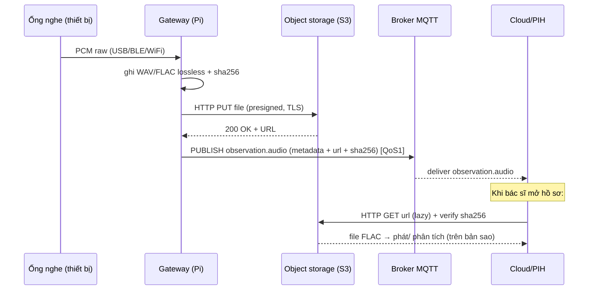
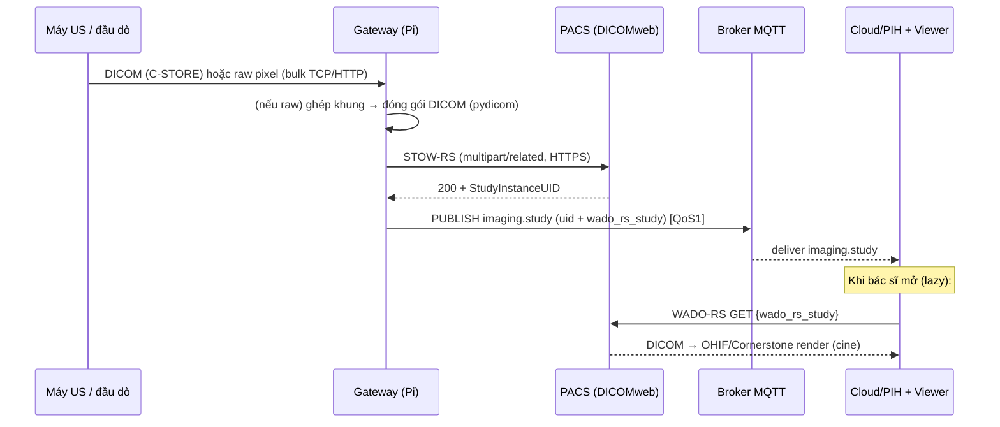

# Cơ chế truyền AUDIO (ống nghe) & ẢNH (siêu âm) — chi tiết

Giải thích end-to-end: từ cảm biến/đầu dò → gateway → hạ tầng lưu/stream → bản tin MQTT
điều khiển → consumer trên Cloud. Áp dụng **nguyên tắc tách Control plane / Data plane**.

```
            CONTROL PLANE (nhỏ, tin cậy, MQTT 5.0/WSS)         DATA PLANE (lớn, HTTP/WebRTC/DICOMweb)
  Thiết bị ───────► Gateway ──observation.audio/imaging.study──► Cloud/PIH        Âm thanh/Ảnh đi đường RIÊNG
                       │  (chỉ metadata + tham chiếu URL)          │              (object storage / PACS / WebRTC)
                       └───────────────────────────────────────────┴──► consumer tải/stream khi cần
```

> **Vì sao không nhồi vào MQTT (số liệu cụ thể):** 1 bản tin MQTT nên ≤ vài KB. Một đoạn
> **cine siêu âm** 30 khung 800×600×2 byte ≈ **28 MB**; một **bản ghi tim** 15s/8kHz/16-bit ≈
> **240 KB** (chưa nén). Nhồi base64 làm phình **+33%**, vượt `message_size_limit` của broker,
> chặn hàng đợi vitals/alarm, retry QoS tốn băng thông gấp bội. → Dữ liệu lớn đi **data plane**,
> MQTT chỉ mang **tham chiếu**.

---

# PHẦN A — ỐNG NGHE ĐIỆN TỬ (`observation.audio`)

## A1. Chuỗi thu tín hiệu (dưới mạch)

```
Âm tim/phổi (rung cơ học)
  → Cảm biến: màng + piezo HOẶC MEMS microphone (áp lên thành ngực)
  → AFE (analog front-end): tiền khuếch đại + chống aliasing (anti-alias LPF ~ fs/2)
  → ADC: ≥16-bit, fs ≥ 4 kHz (mẫu v2.1: 8 kHz / 16-bit / mono)
  → Firmware: ghép khung PCM vào buffer — KHÔNG lọc/nén mất dữ liệu (giữ RAW)
```

Thông số quyết định chất lượng chẩn đoán:
| Thông số | Khuyến nghị | Lý do |
|---|---|---|
| `sample_rate_hz` | ≥ 4 kHz (tim), ≥ 8 kHz (phổi) | Nyquist: bắt tới fs/2; ran/wheeze có thành phần ~1–2 kHz |
| `bit_depth` | 16-bit (hoặc 24-bit) | Dải động đủ cho cả tiếng tim yếu lẫn mạnh |
| `channels` | 1 (mono) | Một đầu nghe; stereo chỉ khi có 2 cảm biến |
| `filter_mode` | **raw** | Giữ nguyên tín hiệu ADC; lọc là bước xử lý SAU |

## A2. Hai đường truyền — tách rõ theo mục đích

### A2.1 LIVE — nghe trực tiếp (ưu tiên ĐỘ TRỄ)

Dùng **WebRTC** (hoặc RTP/SRTP). Pipeline và **ngân sách độ trễ** (mục tiêu ~150–250 ms):

```
mic → capture buffer (~10ms) → [Opus encode ~5–20ms] → RTP packetize → SRTP (mã hoá)
   → ICE/STUN/TURN (xuyên NAT) → SFU/media server → bác sĩ: jitter buffer (~40ms) → giải mã → loa
```

| Giai đoạn | Độ trễ điển hình |
|---|---|
| Capture + đóng gói | 10–20 ms |
| Mã hoá Opus (nếu dùng) | 5–20 ms |
| Mạng (RTT/2) | 30–120 ms |
| Jitter buffer phía nghe | 20–60 ms |
| **Tổng** | **~150–250 ms** |

- Vận chuyển: **RTP** trên UDP, mã hoá **SRTP**; khoá trao đổi bằng **DTLS-SRTP**.
- Xuyên NAT/tường lửa: **ICE** + **STUN** (tự dò địa chỉ) + **TURN** (relay khi P2P fail).
- Codec: **Opus** bitrate cao cho nghe tức thời (hoặc PCM qua LAN). *Live là để nghe ngay —
  KHÔNG phải bản lưu chẩn đoán.*
- Bản tin MQTT chỉ mang **endpoint** để bác sĩ bấm "nghe": `live.endpoint = wss://media…/live/ste-001`.

### A2.2 RECORD — lưu hồ sơ (ưu tiên CHẤT LƯỢNG, lossless)

```
PCM raw → đóng container WAV hoặc nén FLAC (lossless) → sha256 → upload object storage (HTTP) → URL
```

**Cấu trúc file (byte-level):**
- **WAV (PCM):** header **44 byte** (`RIFF....WAVEfmt ` + `data`) + dữ liệu PCM thô
  (`bit_depth/8 × channels × n_samples` byte). Ví dụ 12s/8kHz/16-bit/mono = 44 + 192,000 = **192,044 B**.
- **FLAC (lossless):** chuỗi *frame* nén không mất dữ liệu; giải mã lại **khớp từng bit** với PCM gốc.
  Thực đo trong repo: 192,044 B → **139,337 B (−27.4%)**, `flac -d` khớp bit-exact. Dùng
  `flac --best`; **KHÔNG** dùng MP3/AAC/Opus cho bản lưu (lossy xoá mất murmur/ran/wheeze).

**Vì sao lossless bắt buộc:** âm tim/phổi mang thông tin bệnh lý ở biên độ nhỏ và dải tần hẹp;
nén mất dữ liệu hoặc lọc sai có thể **xoá tiếng thổi (murmur), ran, wheeze** — mất chẩn đoán.
Lọc dải (tim 20–200 Hz, phổi 100–2000 Hz) chỉ làm **trên bản sao** khi hiển thị/phân tích.

## A3. Upload lên object storage (data plane) — chi tiết

```
Gateway → HTTP PUT (presigned URL, TLS)
  Headers: Content-Type: audio/flac | audio/wav
           Content-Length, x-amz-content-sha256 (hoặc Content-MD5)
  Body: toàn bộ file (hoặc multipart nếu lớn)
  ← 200/201 OK → URL cố định (s3://… hoặc https://…)
```
- **Presigned URL**: cloud cấp URL có chữ ký + hạn; gateway PUT thẳng, không lộ khoá.
- **Toàn vẹn**: gửi kèm `sha256`; storage/consumer verify khi tải lại → phát hiện file hỏng.
- **File lớn / mạng yếu**: **multipart upload** (chia phần, mỗi phần có ETag, resume phần lỗi).
- **Mất mạng**: gateway **lưu cục bộ** (store-and-forward), upload lại khi có mạng, **chỉ publish
  `observation.audio` SAU KHI upload xong** (URL đã tồn tại thì consumer mới tải được).

## A4. Bản tin MQTT `observation.audio` — bóc từng trường

Topic: `pvl/v2/gw/GW-ROBOT-DEV-001/up/observation.audio` (**không** có `patient_id` — rule #10).
Kích thước ~1.5 KB. Payload (rút gọn, chú thích ý nghĩa):

```jsonc
"payload": {
  "recording": {
    "recording_id": "STE-001-REC-000108",  // định danh bản ghi (truy vết)
    "modality": "auscultation",
    "format": "flac", "codec": "flac",      // hoặc wav / pcm_s16le
    "sample_rate_hz": 8000, "bit_depth": 16, "channels": 1,
    "duration_sec": 12.0,
    "lossless": true                        // ⬅ bản lưu LUÔN true (test kiểm tra)
  },
  "acquisition": { "body_site": "mitral (heart apex)",  // vị trí nghe
                   "filter_mode": "raw", "gain_db": 0 }, // raw = chưa lọc
  "storage": { "type": "s3",
               "url": "s3://pvl-audio/.../auscultation.flac",  // nơi TẢI file
               "sha256": "28a7c754…",                          // kiểm toàn vẹn
               "size_bytes": 139337 },                          // khớp file thật
  "live": { "enabled": true, "protocol": "webrtc",
            "endpoint": "wss://media.pavalife.com/live/ste-001",
            "codec": "opus", "latency_target_ms": 200 }          // đường nghe trực tiếp
}
```

## A5. Trình tự end-to-end (ghi hồ sơ)



Đường **live** chạy song song: `D → SFU (WebRTC) → C` khi bác sĩ bấm "nghe", dùng `live.endpoint`.

## A6. Tình huống biên (audio)
| Tình huống | Xử lý |
|---|---|
| Mất mạng khi ghi | Lưu cục bộ, upload lại, publish sau khi có URL |
| Upload dở dang | Multipart resume; chưa đủ phần thì **không** publish |
| sha256 không khớp khi tải | Consumer loại file hỏng, yêu cầu gửi lại |
| Chỉ cần nghe nhanh | Dùng live (WebRTC); không tạo bản lưu |

---

# PHẦN B — SIÊU ÂM (`imaging.study`)

## B1. Vật lý tạo ảnh (tóm tắt)

Đầu dò (transducer) phát xung **siêu âm** bằng tinh thể áp điện; sóng phản xạ tại ranh giới
mô quay lại; đo **thời gian về** (⇒ độ sâu) và **cường độ** (⇒ độ sáng) để dựng từng điểm →
ảnh **B-mode** 2D (quạt). Chuỗi khung liên tiếp = **cine loop** (đoạn video siêu âm), kèm
`frame_rate`.

## B2. Hai kịch bản phần cứng

### B2.1 — Máy US thương mại (tự xuất DICOM)
Gateway chỉ **relay**, không chạm pixel:
```
Máy US ──DICOM C-STORE (DIMSE, TCP:104)──► Gateway (đóng vai C-STORE SCP)
Gateway ──DICOMweb STOW-RS (HTTPS)──► PACS  → lấy StudyInstanceUID
Gateway ──MQTT imaging.study──► Cloud (tham chiếu study)
```
Thư viện: `pynetdicom` (C-STORE SCP) + `dicomweb-client` (STOW-RS).

### B2.2 — Đầu dò/SoC chỉ xuất RAW pixel
Đầu dò yếu **không** nên tự làm DICOM. Phân vai:
- **Firmware đầu dò:** số hoá B-mode, (nén nhẹ JPEG/H.264 nếu có encoder), gắn metadata
  (probe_id, depth_cm, gain, frame_rate, timestamp, patient_binding). Truyền lên gateway bằng
  **kênh bulk tin cậy** — **KHÔNG MQTT**.
- **Gateway (Pi):** nhận khung raw → ghép → **đóng gói DICOM** (pydicom) → STOW-RS → publish.

**Thoả thuận raw pixel (bắt buộc để không hỏng ảnh):**
| Hạng mục | Quy ước |
|---|---|
| `pixel_format` | `gray8` (1 byte) hoặc `gray16` little-endian (2 byte) |
| Bố cục | row-major, gốc **trên-trái**, `width×height` cố định cả loạt |
| Thứ tự frame | liên tiếp theo `frame_index` tăng dần |
| Toàn vẹn | `len(data) == width×height×bytes×frame_count` + **sha256** |

## B3. Truyền raw pixel lên gateway (data plane, KHÔNG MQTT)

```
[Khung raw] mỗi khung:  HEADER (frame_index:u32, width:u16, height:u16, fmt:u8, crc32:u32)
                        + PAYLOAD (width*height*bytes)
Vận chuyển: TCP/HTTP(S) POST theo khối (chunked) HOẶC WebSocket nhị phân
  - mỗi khối có checksum (crc32/sha256); gateway xác minh, yêu cầu gửi lại khối lỗi (resume)
  - BLE quá chậm cho cine → chỉ hợp ảnh tĩnh; ưu tiên WiFi/USB/Ethernet
```

## B4. Gateway đóng gói DICOM (pydicom) — các trường cốt lõi

```python
ds.SOPClassUID   = "1.2.840.10008.5.1.4.1.1.6.1"     # US Image Storage
ds.Modality      = "US"
ds.Rows, ds.Columns            = height, width
ds.SamplesPerPixel             = 1
ds.PhotometricInterpretation   = "MONOCHROME2"
ds.BitsAllocated = 8/16; ds.BitsStored = 8/16; ds.HighBit = 7/15
ds.PixelRepresentation = 0                            # unsigned
ds.NumberOfFrames = len(frames)                       # multi-frame = cine
ds.PixelData = <bytes các khung nối tiếp>
# + StudyInstanceUID / SeriesInstanceUID / SOPInstanceUID (sinh từ OID gốc)
# + FileMetaInformation + TransferSyntax (Explicit VR LE 1.2.840.10008.1.2.1,
#   hoặc JPEG/JPEG2000/HEVC nếu nén cine)
```
UID sinh từ **OID gốc** được cấp cho tổ chức (PavaLife phải cung cấp — Phụ lục C).

## B5. Đẩy ảnh lên PACS — DICOMweb STOW-RS (HTTPS)

Request **multipart/related** (mỗi part là 1 instance DICOM):
```
POST /dicom-web/studies  HTTP/1.1
Content-Type: multipart/related; type="application/dicom"; boundary=XXXX
Authorization: Bearer <token>  (hoặc mTLS)

--XXXX
Content-Type: application/dicom
<bytes file DICOM instance 1>
--XXXX--
```
Phản hồi `200` kèm XML/JSON chứa **StudyInstanceUID** đã lưu. (Thay thế cổ điển: **C-STORE/DIMSE**
trên TCP:104 trong LAN bệnh viện, cần cấu hình AE Title.)

## B6. Bản tin MQTT `imaging.study` — bóc từng trường

Topic: `pvl/v2/gw/GW-ROBOT-DEV-001/up/imaging.study` (không `patient_id`). **Không có pixel.**
```jsonc
"payload": {
  "study":  { "study_instance_uid": "1.2.826.0.1.3680043.8.498.100.107",
              "modality": "US", "number_of_instances": 24, "body_site": "Abdomen" },
  "series": [ { "series_instance_uid": "…", "modality": "US" } ],
  "storage": {
    "type": "dicomweb",
    "wado_rs_study": "https://pacs.pavalife.com/dicom-web/studies/<uid>",  // nơi LẤY ảnh
    "stow_rs":       "https://pacs.pavalife.com/dicom-web/studies",        // nơi đã lưu
    "thumbnail_url": ".../thumbnail",                                       // xem nhanh
    "transfer_syntax": "1.2.840.10008.1.2.4.50"                            // JPEG Baseline
  }
}
```

## B7. Trình tự end-to-end (siêu âm)



## B8. Tình huống biên (siêu âm)
| Tình huống | Xử lý |
|---|---|
| STOW-RS lỗi mạng | Lưu DICOM cục bộ, thử lại; publish sau khi PACS nhận |
| Thiếu OID gốc | Không sinh UID hợp lệ → xin PavaLife (Phụ lục C) |
| Chỉ cần ảnh tham khảo nhanh | `storage.type=s3` lưu JPEG/MP4, bỏ PACS (telemedicine) |
| Số byte raw ≠ w×h×bytes×frames | Loại loạt, yêu cầu gửi lại (sai thoả thuận pixel) |

---

# So sánh lựa chọn data plane

| Cách | Giao thức | Khi nào | Ghi chú |
|---|---|---|---|
| Object storage (S3) + presigned | HTTPS | Audio, ảnh/clip tham khảo | Rẻ, tự quản metadata |
| DICOMweb STOW/WADO-RS | HTTPS | Ảnh vào PIH/bệnh án | Qua proxy/firewall dễ, chuẩn |
| DICOM C-STORE (DIMSE) | TCP:104 | Máy US ↔ PACS trong LAN | Cổ điển, cần AE Title |
| WebRTC/RTP (SRTP) | UDP | **Audio LIVE** độ trễ thấp | Cần STUN/TURN/SFU |
| ❌ base64 trong MQTT | MQTT | **Không dùng** | Phình payload, nghẽn broker |

**Điểm chung:** MQTT = control plane (tham chiếu nhỏ, QoS1, `message_id` khử trùng); dữ liệu
nặng đi data plane; `patient_id` chỉ trong payload (rule #10); toàn vẹn bằng `sha256`/checksum;
mất mạng thì store-and-forward rồi publish **sau khi** dữ liệu đã nằm ở storage/PACS.

> Xem thêm: [`AUDIO_DESIGN.md`](AUDIO_DESIGN.md), [`IMAGING_DESIGN.md`](IMAGING_DESIGN.md).
> Kết nối broker để publish các bản tin này: [`KET_NOI_BROKER.md`](KET_NOI_BROKER.md).
